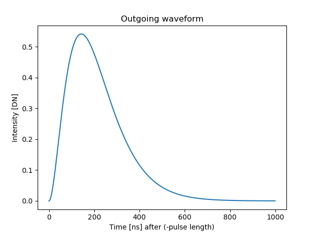
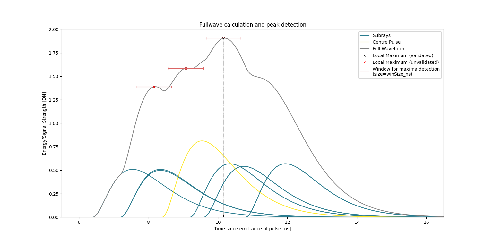
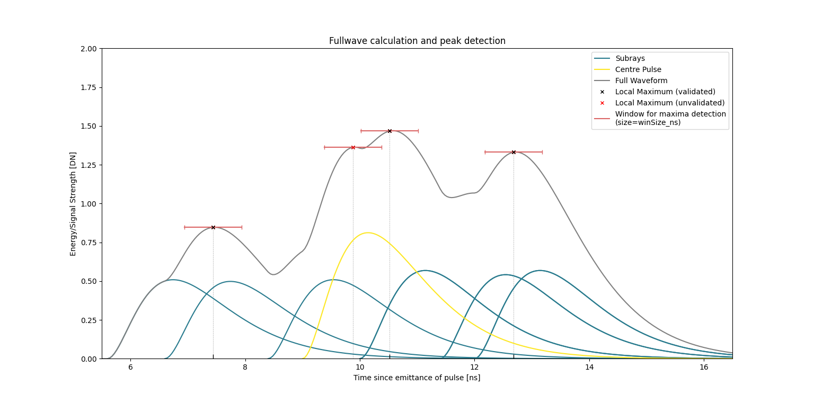
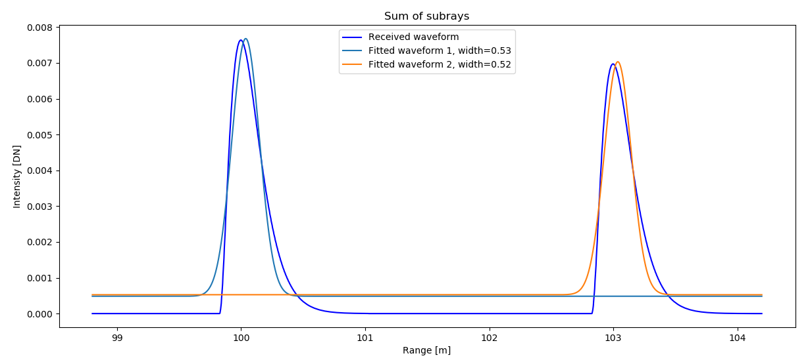

Full waveform and intensity modelling
=====================================

Radiometry calculation API
-------------------------

``EnergyModel`` and scanner calculation methods use incidence cosine and ranges in metres. ``computeReceivedPower`` and ``computeEmittedPower`` return watts. ``computePowerRatio`` returns received power divided by whole-beam emitted peak power, including the absolute subray share. ``WithSigma`` variants accept the existing external scattering value, including the LadLut convention. ``computeTargetArea`` returns the transverse subray patch area in square metres. Python exposes the corresponding snake_case names and keyword arguments::

   power_W = model.compute_received_power(
       incidence_cosine=math.cos(angle_rad), target_range_m=100.0,
       material=material, subray_index=0)
   area_m2 = model.compute_target_area(target_range_m=100.0, subray_index=0)

Migration from the previous API requires replacing argument objects with direct arguments, passing cosine instead of incidence angle, and using ordinary range instead of squared range for target area. The old intensity/transfer names and ``compute_cross_section`` are removed. Received-power values are now watts, so their numerical values are the former values divided by ``1e9``.

Waveform and point-cloud output scaling remains unchanged. Conversion to the existing nanowatt scale occurs at waveform and intersection-handling boundaries. Analytics records retain their schema and watt-valued power columns. The BRDF column contains the angular reflectance response, including incidence cosine where applicable.

Fullwave processing
-------------------

HELIOS++ supports simulation of full waveform data by simulating a laser beam cone of finite divergence via sampled subrays.

Beam divergence
^^^^^^^^^^^^^^^

The scanner XML attributes ``beamDivergenceX_rad`` and ``beamDivergenceY_rad`` define full-angle divergences at the Gaussian 1/e² intensity boundary. The axes are emitter-local right and up. HELIOS uses local forward as the propagation axis. Emitter orientation rotates the ellipse with the beam.

``beamDivergence_rad`` remains circular shorthand. At each scanner or channel:

* No divergence attributes: inherit the parent pair (root default: 0.0003 rad on both axes).
* One axis alone: use that value for both axes.
* Two axes: use the explicit pair.
* Scalar plus axes: use the scalar for both, then override the explicitly supplied axes.

For example::

   <scanner ... beamDivergenceX_rad="0.0003" beamDivergenceY_rad="0.0006">
     <channels>
       <channel id="0" /> <!-- inherits the ellipse -->
       <channel id="1" beamDivergence_rad="0.0004" /> <!-- circular -->
     </channels>
   </scanner>

In Python, configure divergence before running a simulation::

   scanner.set_beam_divergences("0.03 deg", "0.06 deg", index=1)
   scanner.beam_divergence_x = 0.0003  # changes only X, channel 0
   scanner.beam_divergence_y = 0.0006  # changes only Y, channel 0
   y = scanner.get_beam_divergence_y(index=1)
   scanner.beam_divergence = 0.0003  # sets BOTH axes to a circular beam
   x = scanner.get_beam_divergence(index=1)  # legacy getter returns X

Both divergences must be finite and strictly between zero and pi radians. Setters refresh the sampling geometry. Invalid updates preserve the previous beam. Each channel owns its own pair and sampling table.

Subray quantification
^^^^^^^^^^^^^^^^^^^^^

The quality of the simulation can be adjusted by the ``beamSampleQuality`` attribute of the ``<FWFSettings [...]/>`` tag in the survey XML. If no information is given there, the scanner definition may have a set of ``FWFSettings`` instead. If this is also not present, hardcoded default values are used, as shown in the following table:

.. list-table:: HELIOS++ Pulse Sampling and Timing Parameters
   :widths: 25 20 55
   :header-rows: 1

   * - **Attribute**
     - **Default Value**
     - **Comment**

   * - ``beamSampleQuality``
     - 3
     - 3 concentric elliptical rings of subrays, 19 subrays total; discretization in space.

   * - ``beamSamplingFactor``
     - 2
     - Dimensionless cutoff rho_max in normalized Gaussian coordinates; captures 99.9665% of emitted power.

   * - ``sampleSpacing_m``
     - 0.03747405725
     - Fixed sample spacing in metres (equivalent to 0.25 ns round-trip time).

   * - ``maxRecordingSpan_m``
     - 0
     - Maximum recording span from its first sample; zero means unlimited.

   * - ``peakWindow_m``
     - 0.149896229
     - Peak validation neighborhood in metres; at least twice the sample spacing.

   * - ``pulseShape``
     - gamma
     - Unit-peak shape: ``gamma`` or ``gaussian`` in XML; Python/YAML also support ``sampled``.

   * - ``gaussianMean_ns``
     - 0
     - Signed reference-to-peak offset for the Gaussian, in nanoseconds.

   * - ``correctPeakOffset``
     - true
     - Subtract the shape's peak offset when reporting ranges.

   * - ``recordingTailTolerance``
     - 0.0001
     - Relative unit-peak amplitude for automatic recording bounds only.

The quality :math:`Q` is the number of rings, including the central ray. Set :math:`\rho_{\max}=\text{beamSamplingFactor}`. For ring :math:`i`,

.. math::
   \rho_i=\frac{\rho_{\max}i}{Q-1/2},\qquad
   \rho_{i,\mathrm{in}}=\frac{\rho_{\max}\max(0,i-1/2)}{Q-1/2},\qquad
   \rho_{i,\mathrm{out}}=\frac{\rho_{\max}(i+1/2)}{Q-1/2}.

The final boundary is exactly :math:`\rho_{\max}`. A single central ray represents the whole sampled ellipse for :math:`Q=1`. Ring populations are :math:`N_0=1` and :math:`N_i=\lfloor2\pi i\rfloor` for :math:`i>0`. The total is :math:`1+\sum_{i=1}^{Q-1}\lfloor2\pi i\rfloor`.

Samples are uniform in scaled azimuth :math:`\phi`, starting at local up and progressing toward local right. With :math:`a_x=\tan(\beta_x/2)` and :math:`a_y=\tan(\beta_y/2)`, transverse slopes are

.. math::
   u=\rho_i a_x\cos(\phi),\qquad v=\rho_i a_y\sin(\phi),\qquad
   \mathbf d=\frac{\mathbf{forward}+u \mathbf{right}+v \mathbf{up}}
                     {\sqrt{1+u^2+v^2}}.

The physical polar angle is :math:`\theta=\arctan\sqrt{u^2+v^2}` and varies around an elliptical ring. Scaled azimuth is generally different from physical azimuth. The directional boundary angle is

.. math::
   \theta_{\mathrm{out}}(\phi)=\arctan\left(
   \rho_{\mathrm{out}}\sqrt{a_x^2\cos^2(\phi)+a_y^2\sin^2(\phi)}\right).

Equal divergences recover a circular Gaussian.

Subray metadata exposes ``rho``, ``inner_rho``, and ``outer_rho`` in Python. These are dimensionless; ``outer_rho`` is the individual annulus boundary, while ``beamSamplingFactor`` is the global cutoff. ``angle_rad`` remains the individual ray's physical polar angle.

.. _amplitude_evaluation:

Amplitude Evaluation
--------------------

For each subray, the returned waveform is computed by intersecting the ray with the scene. If a hit occurs, the ray does not propagate further.

The received amplitude is derived from the LiDAR equation, considering the following components:

1. **Transmitted power**
   Geometry and weights use an elliptical far-field Gaussian with radii :math:`w_x=za_x` and :math:`w_y=za_y` at axial distance :math:`z`. The fraction of total emitted power assigned to each subray on ring :math:`i` is

   .. math::
      s_i=\frac{e^{-2\rho_{i,\mathrm{in}}^2}-e^{-2\rho_{i,\mathrm{out}}^2}}{N_i}.

   Shares are equal within a ring and independent of both divergences. They sum to :math:`1-e^{-2\rho_{\max}^2}`, independently of range and sample quality. The transverse patch area is

   .. math::
      A_i=\frac{\pi a_xa_y}{N_i}
          (\rho_{i,\mathrm{out}}^2-\rho_{i,\mathrm{in}}^2)z^2,
      \qquad z=R\cos\theta.

   Here :math:`R` is the distance along the individual subray, not axial range.

2. **Material reflectance**  
   The surface reflectance is modeled using Phong's Bidirectional Reflectance Distribution Function (BRDF) :cite:p:`Phong.1975`.

3. **Target cross section**  
   The effective cross section is computed based on the area illuminated by the subray and the local incidence angle.

4. **Atmospheric and system efficiency**  
   Includes atmospheric attenuation and system transmission losses.

See also: :ref:`intensity-modelling`.

Incidence evaluation uses the cosine directly during ray tracing. For normalized ray direction and surface normal, the smaller incidence angle has cosine :math:`c = |\mathbf{n}\cdot\mathbf{d}|`. The Phong angular reflectance response is computed without recovering the angle:

.. math::
   f = \rho\left[(1-K_s)c + K_s |2c^2-1|^{N_s}\right].

Angle-based APIs remain available. The cosine path also supports normal-based voxels and their closest-face fallback. Detailed analytics convert the cosine back to radians only when recording the incidence angle.

Pulse shapes in range coordinates
---------------------------------

The implementation uses the abstract ``PulseShape`` interface with ``GammaPulse``, ``GaussianPulse``, and ``SampledPulse`` implementations. Each scanning device holds an immutable prepared pulse selected by the factory. Waveform assembly uses the same interface for all shapes.

Reconstruction and peak extraction use metres. The scanner's ``pulseLength_ns`` remains a temporal FWHM specification and is converted once using :math:`x=ct/2`. Subray returns retain their exact geometric ranges :math:`r_i` and dimensionless received/whole-beam peak-power ratios :math:`A_i`.

The default gamma pulse is

.. math::
   g(u)=\begin{cases}
   \frac{e^2}{4}(u/\rho)^2\exp(-u/\rho), & u\geq0,\\
   0, & u<0,
   \end{cases}
   \qquad \rho=\frac{cT_\mathrm{FWHM}}{2\times3.394680670846504}.

Its reference is the onset and its peak is at :math:`2\rho`. The alternative Gaussian is

.. math::
   g(u)=\exp\left[-\frac{(u-\mu_r)^2}{2\sigma_r^2}\right],
   \qquad \sigma_r=\frac{cT_\mathrm{FWHM}}{4\sqrt{2\ln2}}.

The Gaussian mean is configurable and defaults to zero: its reference then lies at its peak. A temporal mean converts to range coordinates as :math:`\mu_r=c\mu_t/2`. It has no exact onset: its negative-offset tail is retained. Both shapes have unit analytic peak.

Calculating the detector signal
------------------------------

At each range sample :math:`x_k`, HELIOS++ directly evaluates

.. math::
   S(x_k)=P_0\sum_i A_i g(x_k-r_i).

For gamma, automatic bounds extend from the nearest return to the furthest return plus the falling-flank tolerance crossing. For Gaussian, the pulse-relative bounds are :math:`\mu_r\pm\sigma_r\sqrt{-2\ln\epsilon}`. These bounds are combined with the nearest and furthest return. The tolerance controls the recording interval, not an absolute error bound for the summed signal.

The grid is anchored at range zero; automatic bounds round outwards to grid points. ``maxRecordingSpan_m``, if positive, caps the interval from its first sample without including a sample beyond the cap. Distant returns increase sample count and memory, never the sample spacing. Allocation/index overflow raises an error rather than silently reducing resolution.

Peak extraction and timing reference
-----------------------------------

The existing neighborhood and amplitude-threshold checks operate on the summed samples. With ``correctPeakOffset=true``, a detected peak at :math:`x` produces range :math:`x-2\rho` for gamma or :math:`x-\mu_r` for Gaussian (or :math:`x-p` for a sampled pulse with reference peak :math:`p`). Disabling correction reports :math:`x` directly. Correction precedes object attribution and measurement-error processing and never changes the waveform itself.

Waveform export retains its existing layout. Endpoint metadata is physical round-trip time in nanoseconds, calculated from the recorded range coordinates using :math:`t=2x/c`. It is unaffected by range correction. As before, export requires an accepted return, and optional waveform noise is added after point extraction.

Configuration migration
-----------------------

Python uses ``sample_spacing``, ``peak_window``, ``max_recording_span``,
``pulse_shape``, ``gaussian_mean``, ``correct_peak_offset``, and ``recording_tail_tolerance``::

   settings = helios.FullWaveformSettings(
       sample_spacing="2 cm", peak_window="10 cm",
       pulse_shape="gaussian", gaussian_mean="0 ns", correct_peak_offset=True,
       recording_tail_tolerance=1e-4,
   )

Old XML ``binSize_ns``, ``winSize_ns``, and ``maxFullwaveRange_ns`` inputs and Python constructor ``bin_size``, ``win_size``, and ``max_fullwave_range`` inputs are deprecated. They convert to metres using :math:`c/2`; specifying both names for one setting is an error. Old YAML documents migrate to these settings and new serialization writes only the range fields.

The old ``prepare_discretization``, template-array, sample-count, peak-index, and ``calc_time_propagation`` APIs are removed. Use ``prepare_pulse``, ``get_pulse_model`` (evaluation and peak offset), and ``recording_grid`` instead. The historical ``receivedEnergyMin_W`` setting still compares directly with legacy intensity samples; its unit naming is not changed in this refactor.

Sampled pulse shapes in Python and YAML
--------------------------------------

Custom pulses are supplied as relative time coordinates and nonnegative amplitudes::

   pulse = helios.SampledPulse(
       offsets=["-2 ns", "0 ns", "3 ns"],
       amplitudes=[0, 1, 0],
   )
   survey.full_waveform_settings = helios.FullWaveformSettings(
       pulse_shape="sampled", sampled_pulse=pulse,
   )
   survey.to_yaml("survey.yaml", shallow=True)

Bare numeric offsets and ``peak_offset`` use seconds in the high-level Python API. Coordinates must be finite and strictly increasing; nonuniform spacing is supported. At least two samples are required. Amplitudes must be finite, nonnegative, and have a positive maximum. They are normalized to unit peak, leaving absolute peak power under the scanner's amplitude setting.

Evaluation uses linear interpolation between supplied samples and zero outside the supplied interval, retaining the endpoint values themselves. The full interval sets the recording bounds. ``recording_tail_tolerance`` and scanner pulse length do not truncate or stretch sampled shapes. Internal ``sample_spacing`` remains independent of the supplied sampling density, but interpolation cannot recover features absent from the input samples.

The reference peak is inferred for a unique maximum. Tied maxima or a maximum plateau require an explicit ``peak_offset`` located at a maximum of the interpolated shape. That same reference is subtracted from every detected peak.

Settings retain custom definitions through preparation, copying, and both inline and referenced YAML round trips. Configure pulses before running the simulation. Concurrent reconfiguration is unsupported. Custom pulse input is not supported in XML. Changing ``pulse_shape`` to an analytic shape retains but ignores ``sampled_pulse``.

Low-level ``SampledPulse`` constructor coordinates are explicitly named ``offsets_ns`` and ``peak_offset_ns`` and use nanoseconds. All runtime models evaluate offsets and expose ``peak_offset`` and ``recording_bounds`` in range-equivalent metres.

Echo width determination
------------------------

If the command line parameter ``--calcEchoWidth`` was provided, a Gaussian curve is fitted to the waveform. This is an optional Gaussian-fit estimate, which may not describe asymmetric or custom pulse shapes accurately. The existing fitter reports the width parameter of ``exp(-((x-centre)/width)^2)``, equal to sqrt(2) times the Gaussian standard deviation. As shown in the following figure, the maximum of the Gaussian does not align with the maximum of the pulse shape. The detected sample maximum, with the optional shape offset correction, determines range. The fitted Gaussian centre does not replace it. For an isolated ideal return, sampling uncertainty is bounded by one sample spacing (about 3.75 cm at the default). The fitted sample-index width is converted to metres. The reported ``echo_width`` retains nanoseconds through conversion with :math:`2/c`.

.. _intensity-modelling:

Intensity modelling
--------------------

The laser return intensity values are calculated using the laser radar equation.

Currently, for its calculation HELIOS++ takes the following factors into account (wide table, use the scroll bar):

.. list-table:: Factors used for intensity modelling
   :widths: 20 35 20 25
   :header-rows: 1

   * - **Factor**
     - **Description**
     - **Provided by**
     - **Default Value**

   * - Pulse amplitude
     - Whole-beam peak optical power before footprint truncation (watts)
     - User: ``pulseAmplitude_W`` in **scanner XML**
     - 1.0 W (reference amplitude)

   * - Aperture size
     - Receiver aperture diameter (meters)
     - User: ``receiverDiameter_m`` in **scanner XML**
     - 0.15 m

   * - Atmosphere transmission
     - Visibility (km)
     - User: ``atmosphericVisibility_km`` in **scanner XML**
     - 23.0 km

   * - System transmission
     - Energy passed after system inefficiency (dimensionless)
     - User: ``opticalEfficiency`` in **scanner XML**
     - 0.99

   * - Beam divergence
     - Increase of the beam diameter with increasing range (radians)
     - User: ``beamDivergenceX_rad`` / ``beamDivergenceY_rad`` (or circular ``beamDivergence_rad``) in **scanner XML**
     - 0.0003 rad

   * - Range
     - Distance to the target (meters)
     - ``HELIOS++``
     - —

   * - Angle of incidence
     - Angle of incidence to the target (radians)
     - ``HELIOS++``
     - —

   * - Area
     - Area of the target illuminated by the beam (square meters)
     - ``HELIOS++``
     - —

   * - Reflectance
     - Reflectance of the target surface (dimensionless)
     - User: ``helios_reflectance`` in material file (`.mtl`) or ASTER
     - 50% (dimensionless)

   * - Specularity
     - Specularity of the target surface.
       Calculated as: :math:`\sum k_d / \sum (k_d + k_s)`
     - User: ``ks`` and ``kd`` in material file (`.mtl`)
     - —

   * - Specular exponent
     - Controls sharpness of specular highlights (material property)
     - User: ``Ns`` in material file (`.mtl`)
     - —

Material files
--------------

HELIOS++ supports two ways of defining materials:

1. Reading material properties from `MTL material library files`_. Following the standard, these files and their materials are linked to mesh faces using the ``mtllib`` and ``usemtl`` statements in the .OBJ file.
2. Modifying materials using the ``Material`` interface of the Python API.

Further explanations can be found here:

- Python API: `Scene - Material properties <scene.ipynb#Material-properties>`_
- Legacy XML definitions: :ref:`materials_cli`

The default material, in case no material file is provided, looks like this:

.. code-block::

    newmtl default  
    Ka 0.0 0.0 0.0  
    Kd 0.0 0.0 0.0  
    Ks 0.0 0.0 0.0  
    Ns 10  
    helios_classification 0  
    helios_reflectance 50
    helios_isGround true

.. _MTL material library files: http://paulbourke.net/dataformats/mtl/

HELIOS-specific parameters
^^^^^^^^^^^^^^^^^^^^^^^^^^

There are four HELIOS-specific parameters, that can be added to material files by inserting respective lines in the material definitions.

* ``helios_reflectance``: This parameter specifies the reflectance of the target surface, e.g. ``helios_reflectance 70.8``. (default: 50.0)
* ``helios_spectra``: Instead of setting reflectance values of the materials by hand, they can be retrieved from the ECOSTRESS spectral library (formally ASTER spectral library). For each material, this library provides a file specifying its reflectance for different wavelengths in range [0, 100]. HELIOS includes a small set of these spectra in the ``python/helios/data/spectra`` folder, such as asphalt, grass, wood or gray and red shingles. More spectra can be downloaded from NASA's JPL or users can add their own spectra (resulting from spectrometer measurements). The spectra files contained in any asset directory can be referenced by their name, e.g. ``helios_spectra grass``. Now HELIOS++ will select the appropriate reflectance for the material given the wavelength of the laser. If the selected wavelength is not specified in the library (as they are discrete values) the reflectance will be interpolated. If no spectra or reflectance is specified in the .mtl, the reflectance will be set to the default and a warning will be displayed.
* ``helios_classification``: This parameter can be used to assign a classification to different sceneparts, e.g., according the ASPRS Standard (see LAS Specification p. 11), e.g. ``helios_classification 2`` for the ground. This classification will appear as an attribute of the respective simulated point reflected from that scenepart. (default: 0)
* ``helios_isGround``: Boolean parameter, which can have either values "false"/"0" or "true"/"1". If set to "true", geometries with this material are considered ground. This information is used for the ``onGround`` parameters, which can be used to translate sceneparts and platforms. (default: "true")

.. _heliospp_intensity_model:

Intensity calculation from material properties
----------------------------------------------

HELIOS++ intensity is based on Phong's Bidirectional Reflectance Distribution Function (BRDF) reflectance model coupled with the lidar-radar equation. The recorded intensity (signal amplitude) is calculated in three main steps:

1. **BRDF Calculation**

   The BRDF is computed from the material reflectance :math:`\rho` (either set via ``helios_reflectance`` in the `.mtl` file or derived from a `helios_spectra` and the scanner's wavelength) and the specularity :math:`\text{spec}` (defined by the material parameters ``kd`` :math:`(k_d)`, ``ks`` :math:`(k_s)`, and the specular exponent ``Ns`` :math:`(N_s)`). The incidence angle :math:`\varphi` is determined from the ray-object intersection.

   .. math::
      \text{BRDF}_r = \rho \cdot BRDF(\varphi, \text{spec}, N_s)

   where :math:`BRDF` follows the formulation by :cite:t:`JutziGross.2022`:

   .. math::
      BRDF(\varphi, \text{spec}, N_s) = (1 - \text{spec}) \cdot \cos(\varphi) + \text{spec} \cdot \left| \cos(2\varphi^*) \right|^{N_s}

   with :math:`\varphi^* = \varphi - \pi/2` if :math:`\varphi > \pi/2`, otherwise :math:`\varphi^* = \varphi`.

   The specularity :math:`\text{spec}` is computed as:

   .. math::
      \text{spec} = \frac{k_s[0] + k_s[1] + k_s[2]}{k_d[0] + k_d[1] + k_d[2] + k_s[0] + k_s[1] + k_s[2]}

   Please note:

   - If ``ks`` is 0, the material is fully diffuse and the BRDF simplifies to :math:`\text{BRDF}_r = \rho \cdot \cos(\varphi)` (Lambertian reflectance).
   - If both ``kd`` and ``ks`` are 0, the material reflectance is direction-independent and the BRDF simplifies to :math:`\text{BRDF}_r = \rho`.

2. **Lidar Cross Section Calculation**

   The lidar cross section :math:`\sigma` is calculated using the illuminated target area :math:`A`, following :cite:p:`Wagner.2010`, Eq. 14. It is assumed that each sub-ray either fully hits the target or does not hit at all. Partial hits are treated as full hits in intensity simulation.

   .. math::
      \sigma_i = 4\pi \cdot \text{BRDF}_r \cdot A_i

3. **Received Intensity via Lidar-Radar Equation**

   For a subray with absolute power fraction :math:`s_i`, the dimensionless
   received/whole-beam peak-power transfer is:

   .. math::
      H_i = \frac{\pi s_i D_r^2 \eta_{\mathrm{sys}}\,\mathrm{BRDF}_r
                  e^{-2Ra_e}}{4R^2}, \qquad I_i = P_0 H_i.

   For an externally supplied cross section, the corresponding expression is :math:`H_i=s_iD_r^2\eta_{\mathrm{sys}}\sigma_i e^{-2Ra_e}/(16A_iR^2)`. Here :math:`P_0` is whole-beam peak optical power, :math:`A_i` is the subray's transverse target area, :math:`D_r` is receiver diameter, :math:`R` is target range, and :math:`\eta_{\mathrm{sys}}` is system efficiency. The BRDF response above already includes the incidence cosine. It is not applied a second time. The atmospheric extinction coefficient :math:`a_e` in inverse metres uses the Kruse relation:

   .. math::
      a_e = \frac{3.91}{1000 V_M} \left( \frac{\lambda_{\mu\mathrm{m}}}{0.55} \right)^{-q}

   with the exponent :math:`q` defined piecewise:

   .. math::
      q = 
      \begin{cases}
        1.6, & \text{if } V_M > 50\ \text{km} \\
        1.3, & \text{if } 6\ \text{km} < V_M \le 50\ \text{km} \\
        0.585 \cdot V_M^{0.33}, & \text{otherwise}
      \end{cases}

   Here :math:`V_M` is the numerical visibility in kilometres and :math:`\lambda_{\mu\mathrm{m}}` is the numerical wavelength in micrometres. The scanner stores wavelength in metres and converts it to micrometres for this relation. The factor of 1000 converts extinction per kilometre to extinction per metre, matching the range :math:`R` in metres in the two-way atmospheric transmission :math:`\exp(-2 R a_e)`.

   The approximation is applied for wavelengths from 0.5 to 2.0 micrometres, including both endpoints. Outside this range, HELIOS logs a warning and assumes zero extinction (unit atmospheric transmission).

References
----------

.. bibliography:: refs.bib
   :style: apa_recent
   :filter: docname in docnames
